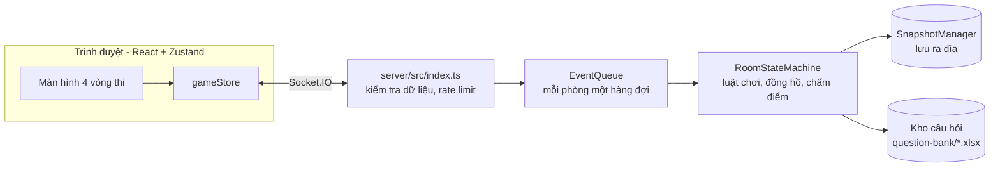

# OLYMPIA NỘI BỘ (v1.1)


Web game thời gian thực, nhiều người chơi, lấy cảm hứng từ định dạng gameshow 4 vòng thi (Khởi động, Vượt chướng ngại vật, Tăng tốc, Về đích) kèm Câu hỏi phụ. Tối đa 5 thí sinh và 10 khán giả trong một phòng, vào bằng mã phòng hoặc QR, không cần tài khoản.

> Dự án học tập phi thương mại. Tên và định dạng chương trình thuộc về đơn vị sở hữu gốc.

---

## Demo

- **Chơi thử:** _(điền link deploy, ví dụ Render)_
- **Video 2 phút:** _(điền link video)_
- **Ảnh chụp màn hình:** _(thêm 2–3 ảnh vào thư mục `docs/` rồi chèn vào đây)_

---

## Bài toán kỹ thuật đã giải

| Bài toán | Cách giải | Ở đâu trong code |
|---|---|---|
| Nhiều người bấm chuông cùng lúc, chỉ một người được thắng | Mọi sự kiện của một phòng đi qua hàng đợi tuần tự; người đầu tiên vào hàng đợi giữ khóa chuông, người sau bị từ chối. Có test 5 bot bấm đồng thời 100 lần | `server/src/game/EventQueue.ts`, `RoomStateMachine.handleBuzzer`, `server/test/concurrencyBuzzer.test.ts` |
| Thí sinh không gian lận được thời gian | Server đặt `deadline` và tự hẹn giờ; bài nộp sau `deadline + 300 ms` (bù trễ mạng) bị từ chối. Client chỉ hiển thị, đồng bộ giờ qua `time:ping` | `RoomStateMachine.setDeadline`, `submitAnswer`, `shared/src/config.ts` |
| Đáp án không lộ xuống trình duyệt | Trạng thái phòng được lọc qua `getSanitizedRoom()` trước khi gửi, bỏ đáp án và đáp án tương đương | `RoomStateMachine.getSanitizedRoom` |
| Tải lại trang vẫn vào đúng ghế | Mỗi người nhận một `token` lưu ở localStorage; sự kiện `room:rejoin` gắn lại kết nối mới vào người chơi cũ. Chủ phòng mất kết nối quá lâu thì tự chuyển quyền | `server/src/index.ts` (`room:rejoin`), `RoomManager.ts` |
| Server khởi động lại giữa trận | Phòng và bộ đề được lưu snapshot ra đĩa, khởi động lại thì nạp lại | `SnapshotManager.ts`, `RoomManager.ts` |
| So đáp án tiếng Việt gõ bằng nhiều bộ gõ | Chuẩn hóa Unicode NFC/NFD, bỏ dấu khi cần, hỗ trợ đáp án tương đương | `shared/src/answerMatcher.ts` |
| Đồng hạng ở vòng Tăng tốc | Hai bài nộp cách nhau không quá 50 ms tính là đồng hạng | `GAME_CONFIG.TANG_TOC.TIE_THRESHOLD_MS` |
| Chống spam | Giới hạn 30 sự kiện/giây mỗi kết nối, giới hạn tạo phòng, rate limit API và upload, kiểm tra kiểu mọi dữ liệu client gửi lên | `server/src/index.ts`, `reactionLimiter.ts` |

---

## Kiến trúc



- **Monorepo:** `shared/` (kiểu dữ liệu, cấu hình, so đáp án dùng chung), `server/`, `client/`
- **Ngôn ngữ:** TypeScript
- **Backend:** Node.js 20, Express, Socket.IO
- **Frontend:** React 18, Vite, Zustand, Tailwind CSS
- **Kiểm thử:** Vitest, 23 file test, hơn 140 test, chạy tự động bằng GitHub Actions
- **Triển khai:** Docker, hoặc Render (`render.yaml`)

---

## Cài đặt và chạy

```bash
npm install
```

Chế độ phát triển, mở 2 terminal:

```bash
npm run dev:server   # Backend, cổng 4000
npm run dev:client   # Frontend, cổng 3000
```

Mở `http://localhost:3000`.

Chạy test:

```bash
npm test
```

Bản production:

```bash
npm run build
npm start            # phục vụ API, Socket.IO và giao diện tại http://localhost:4000
```

Docker:

```bash
docker compose up -d --build
```

---

## Luật chơi và phím tắt

- **Không cần tài khoản:** nhập tên để vào phòng (tối đa 5 thí sinh), nhận ghế 1–5; token lưu trong localStorage để tự kết nối lại khi tải lại trang.
- **Space:** bấm chuông giành quyền trả lời (Khởi động chung, VCNV, Về đích, Câu hỏi phụ).
- **1, 2, 3, 4:** chọn nhanh đáp án A, B, C, D ở vòng Khởi động.
- **Chủ phòng:** nạp bộ đề tùy chỉnh (.xlsx hoặc .json) ở sảnh chờ; sửa kết quả chấm trong 10 giây sau khi công bố đáp án; tải biên bản trận đấu ra CSV.
